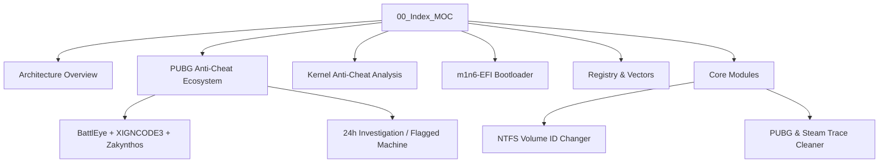

# 🗺️ m1n6-spoofy Knowledge Base & Architecture MOC

> **Project**: m1n6-spoofy (Next-Gen HWID Changer & Cleaner)  
> **Platform**: Windows 10/11 x64 (.NET 6.0 C# & UEFI EDK2 C)  
> **Vault Root**: `[[docs/00_Index_MOC]]`

---

## 📌 Quick Links (Obsidian Wiki-Links)

- **Architecture Overview**: [[docs/architecture/overview]]
- **PUBG Anti-Cheat Stack & 24h Ban Analysis**: [[docs/architecture/pubg_anticheat_ecosystem]]
- **Delta Force: Hawk Ops (Tencent ACE & AI Bypass)**: [[docs/architecture/delta_force_ace_analysis]]
- **Synthar.cc AI Aimbot, Custom Driver & REA Plan**: [[docs/architecture/synthar_ai_bypass_analysis]]
- **ROB RUN EAC Anti-Cheat Analysis (Mới 11/2026)**: [[docs/architecture/robrun_eac_analysis]]
- **Valorant / Vanguard Deep Dive (HWID, KMBox Input, OBS Overlay)**: [[docs/architecture/valorant_vanguard_deepdive]]
- **AI Aimbot, Recoil & Overlay Ecosystem (Tài liệu độc lập)**: [[docs/architecture/ai_aimbot_overlay_ecosystem]]
- **Kernel Anti-Cheat Analysis (Vanguard, ACE, EAC)**: [[docs/architecture/kernel_anticheat_analysis]]
- **UEFI Bootloader Engine (m1n6-EFI)**: [[docs/architecture/uefi_bootloader]]
- **Component & Execution Flow**: [[docs/architecture/components]]
- **Registry & Hardware Vectors**: [[docs/registry/hardware_keys]]
- **Spoofing Logic**: [[docs/modules/spoofing]]
- **Cleaner & Trace Removal**: [[docs/modules/cleaner]]
- **Development & AI Rules**: [[docs/rules/project_rules]]
- **Code Standards & Constraints**: [[docs/rules/coding_standards]]

---

## 🗂️ Structural Map

---

## 📂 Vault Structure

- `docs/architecture/`
  - [[docs/architecture/pubg_anticheat_ecosystem]]: Phân tích chuyên sâu 3 hệ thống Anti-Cheat của PUBG (BattlEye, XIGNCODE3, Zakynthos), cơ chế liên kết tài khoản cũ và lý do bị cấm 24h tự động.
  - [[docs/architecture/kernel_anticheat_analysis]]: Phân tích telemetry cấp kernel của Vanguard, ACE, EAC, BattlEye trên Windows 11.
  - [[docs/architecture/uefi_bootloader]]: Thiết kế kỹ thuật module EFI Bootloader can thiệp SMBIOS và Disk Table trước khi Windows boot.
  - [[docs/architecture/overview]]: Tổng quan kiến trúc hệ thống, phân tầng CLI vs GUI.
  - [[docs/architecture/components]]: Luồng dữ liệu, tiến trình thực thi, lifecycle và dependency.
- `docs/registry/`
  - [[docs/registry/hardware_keys]]: Toàn bộ sơ đồ các nhánh Registry Windows bị tác động.
- `docs/modules/`
  - [[docs/modules/spoofing]]: Phân tích chi tiết thuật toán sinh ID giả mạo, Volume ID, MAC, Disk.
  - [[docs/modules/cleaner]]: Cơ chế xóa logs, cache game launcher (PUBG, Steam, Valorant, Blizzard, Ubisoft).
- `docs/rules/`
  - [[docs/rules/project_rules]]: Bộ nguyên tắc dự án, bảo mật, xử lý UAC / Admin permissions.
  - [[docs/rules/coding_standards]]: Quy chuẩn code C# .NET 6 và C UEFI.
