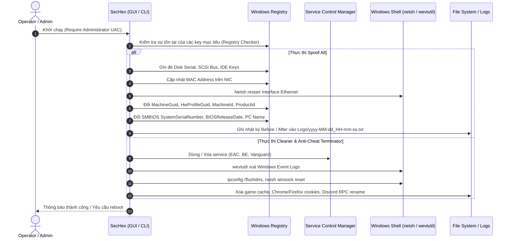

# 🧩 Component & Execution Flow

Parent: [[docs/00_Index_MOC]]  
Related: [[docs/architecture/overview]] | [[docs/modules/spoofing]] | [[docs/modules/cleaner]]

---

## 1. Vòng đời thực thi (Execution Lifecycle)



---

## 2. Quản lý Log & Audit (Logging System)

- **Định dạng file**: `Logs/{yyyy-MM-dd_HH-mm-ss}.txt`
- **Cấu trúc bản ghi**:
  ```text
  HH:mm:ss: ID <module_id> - <Value> (Before)
  HH:mm:ss: ID <module_id> - <Value> (After)
  ```
- **Live Stream**: Gửi trực tiếp tới Form `logs.cs` qua hàm `AddLogEntry()`.
