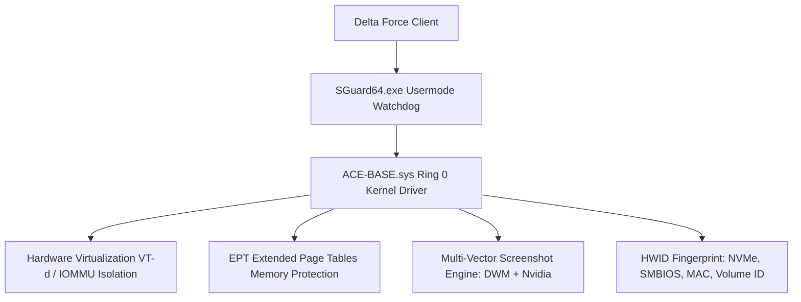
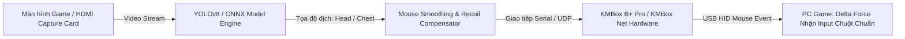

# Delta Force: Hawk Ops — Anti-Cheat Expert (ACE) & AI Bypass Architecture

> [!IMPORTANT]
> Tựa game: **Delta Force: Hawk Ops / Black Hawk** (Tii Games / Tencent)  
> Hệ thống bảo mật: **Tencent Anti-Cheat Expert (ACE)** (`ACE-BASE.sys`, `SGuard64.exe`, `SGuardUpdateService.exe`)  
> Mục tiêu: Phân tích kiến trúc bảo mật cấp kernel của ACE, cơ chế chống DMA/EPT, mô hình AI Aimbot YOLOv8/Aimmy và kỹ thuật làm sạch dấu vết HWID.

---

## 1. Kiến trúc bảo vệ cấp Kernel của Tencent ACE

Tencent ACE được đánh giá là một trong những hệ thống chống gian lận khắt khe nhất hiện nay (tương đương hoặc vượt trội so với Vanguard trên bản China/Global):

### 1.1 Khóa chặn DMA bằng VT-d & IOMMU
- ACE kích hoạt và chiếm dụng kênh ảo hóa phần cứng (**Intel VT-d / AMD-Vi IOMMU**) ngay từ khi Windows nạp driver.
- Gán bảng phân giải bộ nhớ độc lập cho từng thiết bị ngoại vi trên bus PCIe.
- Mọi thiết bị DMA cố tình đọc vùng nhớ được bảo vệ của `DeltaForce-Win64-Shipping.exe` mà không thông qua bảng chuyển đổi địa chỉ IOMMU sẽ kích hoạt ngoại lệ phần cứng lập tức -> Bị cấm thiết bị 7 ngày đến vĩnh viễn.

### 1.2 Bảo vệ bộ nhớ bằng EPT (Extended Page Tables)
- Kiểm tra con trỏ thực thi (Guest RIP) khi truy cập vùng nhớ game. Nếu phát hiện lệnh đọc/ghi xuất phát từ không gian kernel lạ (Mapped driver / vulnerable driver exploit), hệ thống ghi log và gửi cờ telemetry về server Tencent.

### 1.3 Cơ chế chụp ảnh màn hình đa tầng (Screenshot Engine)
- ACE không chỉ dựa vào Windows GDI `BitBlt`. Nó hook trực tiếp vào:
  1. Desktop Window Manager (**DWM**) frame composition buffer.
  2. Nvidia ShadowPlay (**nvspcap64.dll**) swapchain buffer.
- Do đó, các loại Overlay thông thường (cửa sổ Windows trong suốt, TopMost) đều bị chụp dính hình vẽ ESP.

---

## 2. AI Aimbot & Vision System dành riêng cho Delta Force

Do bộ nhớ game được bọc EPT và DMA bị IOMMU chặn, cộng đồng nghiên cứu chuyển dịch 100% sang hướng **AI Vision (Thị giác máy tính)**:

### 2.1 Huấn luyện Model YOLOv8 (Aimmy ONNX)
- Mô hình được huấn luyện với hơn 7.000 frame hình ảnh của nhân vật Delta Force (Operator skins, armor, camo).
- Định dạng xuất: ONNX chạy qua DirectML hoặc TensorRT để đạt tốc độ suy luận dưới 5ms/frame (trên GPU RTX 3060 trở lên).
- Target Class: `0: Head`, `1: Body`, `2: Armor`.

### 2.2 Giải pháp Bypass Input Mouse
- **KMBox B+ Pro / KMBox Net**: Chuột vật lý cắm vào KMBox, KMBox cắm vào PC game. Lệnh di chuột được điều khiển qua cổng COM độc lập, hoàn toàn vô hình trước hook `MouseClassServiceCallback` của `ACE-BASE.sys`.
- **Logitech G HUB virtual driver**: Có thể sử dụng nếu chạy qua profile script nội bộ, nhưng đối với Tencent ACE, giải pháp phần cứng KMBox có tỉ lệ an toàn cao hơn hẳn.

### 2.3 Giải pháp Render Overlay kín (Undetected Overlay)
1. **Direct3D SwapChain Hook trên ứng dụng uy tín**:
   - Hook hàm `Present` bên trong `DiscordHook64.dll` hoặc Steam Overlay.
2. **Kính Fuser phần cứng (Hardware HDMI Overlay / Dual-PC Fuser)**:
   - Trộn tín hiệu hình ảnh của PC game với tín hiệu ESP từ PC thứ 2 trên dây HDMI trước khi xuất ra màn hình. Game và ACE hoàn toàn không có cách nào phát hiện vì ESP tồn tại bên ngoài máy tính.

---

## 3. Quy trình xóa dấu vết & Spoofing cho Delta Force

Khi bị ban HWID hoặc đổi tài khoản Delta Force, các dấu vết cần xử lý triệt để:

### 3.1 Dừng tiến trình & Gỡ Driver
- Kill: `DeltaForce.exe`, `DeltaForce-Win64-Shipping.exe`, `SGuard64.exe`, `SGuard32.exe`, `SGuardUpdateService.exe`.
- Dừng service: `ACE-BASE`.

### 3.2 Thư mục Cache & Bản ghi Telemetry cần xóa
- `%LOCALAPPDATA%\DeltaForce`
- `%APPDATA%\Tencent\AntiCheatExpert`
- `C:\ProgramData\Tencent\AntiCheatExpert`
- `%COMMONPROGRAMFILES%\Tencent\AntiCheatExpert`
- `%COMMONPROGRAMFILES(x86)%\Tencent\AntiCheatExpert`
- Hủy liên kết tài khoản Steam: `Steam\config\loginusers.vdf`, `userdata`.

### 3.3 Hardware Spoofing (m1n6-EFI & m1n6-spoofy)
- Khởi động qua `m1n6-EFI` để ngụy trang NVMe Serial và SMBIOS UUID cấp UEFI.
- Đổi NTFS Volume Serial Number của ổ cài game bằng `VolumeIdChanger`.
- Reset MAC Address và xóa ARP Cache Gateway (`arp -d *`).
