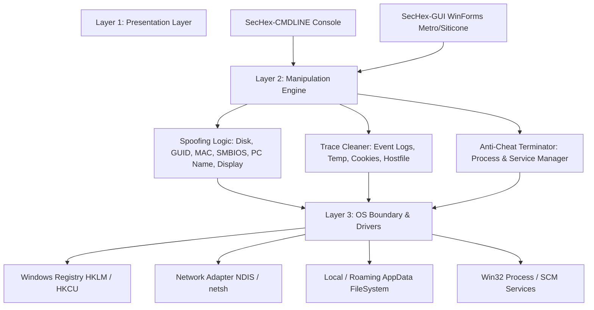

# 🏗️ Architecture Overview

Parent: [[docs/00_Index_MOC]]  
Related: [[docs/architecture/components]] | [[docs/modules/spoofing]] | [[docs/rules/project_rules]]

---

## 1. Bản chất hệ thống (System Nature)

SecHex-Spoofy là công cụ **User-Mode Registry-Level HWID Changer & Cleaner** viết bằng C# chạy trên nền tảng .NET 6.0 (Windows).

> [!NOTE]
> Hệ thống **hoàn toàn hoạt động ở User-Mode (Ring 3)** thông qua việc đọc/ghi Registry (`Microsoft.Win32.RegistryKey`), gọi CLI shell (`netsh`, `ipconfig`, `wevtutil`, `wmic`, `powershell`) và thao tác file hệ thống. Nó **chưa tích hợp Kernel-Mode Driver (Ring 0)**.

---

## 2. Mô hình phân tầng (Layering Architecture)

---

## 3. Thành phần dự án (Project Breakdown)

1. **SecHex-CMDLINE (`RPZ-HWID`)**:
   - Project: Console Application (`.NET 6.0`).
   - Entry point: `Program.cs`.
   - Mục đích: Cung cấp menu dạng text tương tác trực tiếp nhanh chóng, ít phụ thuộc GUI, thao tác tuần tự từng mục tiêu spoofing.

2. **SecHex-GUI**:
   - Project: Windows Forms Application (`.NET 6.0-windows`).
   - Giao diện: MetroFramework kết hợp Siticone.Desktop.UI.
   - Thư viện đóng gói runtime: Costura.Fody (nhúng toàn bộ dependency DLL vào 1 file thực thi duy nhất).
   - Module chính:
     - `Spoofy.cs`: Trung tâm điều khiển spoofing, cập nhật trạng thái, log chi tiết trước/sau khi thay đổi.
     - `cleaner.cs`: Module phụ trách dọn dẹp hệ thống, kill anti-cheat và ngắt kết nối telemetry (Xbox, Discord).
     - `logs.cs`: Window hiển thị audit trail theo thời gian thực.
