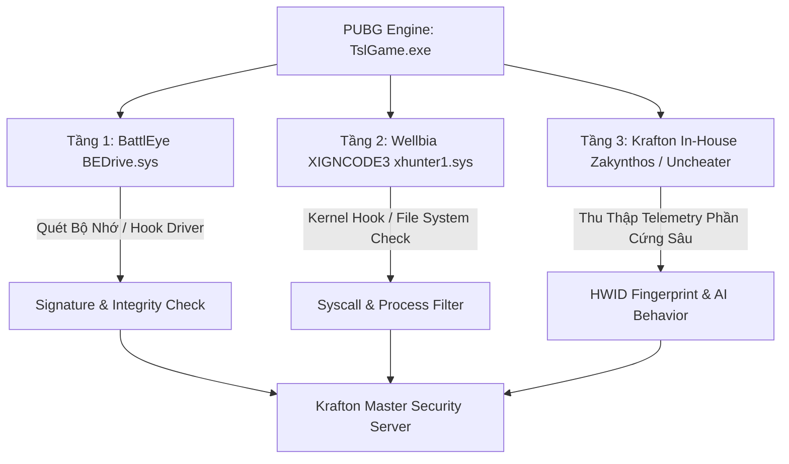

# 🎯 Phân Tích Chuyên Sâu: Hệ Thống Anti-Cheat PUBG & Cơ Chế Ban 24 Giờ

Parent: [[docs/00_Index_MOC]]  
Related: [[docs/architecture/kernel_anticheat_analysis]] | [[docs/modules/cleaner]] | [[docs/modules/spoofing]]

---

## 1. Kiến Trúc Đa Tầng Của PUBG Anti-Cheat (Multi-layered Stack)

Khác với các tựa game chỉ dùng một giải pháp duy nhất, **PUBG (PlayerUnknown's Battlegrounds)** vận hành đồng thời **3 hệ thống Anti-Cheat phối hợp**:

1. **BattlEye (`BEService.exe`, `BEDrive.sys`)**:
   - Chặn injection dll vào `TslGame.exe`.
   - Giám sát open handle, DKOM, hook kernel.
2. **Wellbia XIGNCODE3 (`xhunter1.sys`, `x3.xem`)**:
   - Quét integrity của file hệ thống, driver nạp vào bộ nhớ.
   - Giám sát memory access pattern.
3. **Zakynthos (`TslGame_ZK.exe`, `ucldr_battlegrounds_gl.exe` / `Uncheater`)**:
   - Giải pháp bảo mật độc quyền do Krafton tự phát triển.
   - Thu thập cấu trúc phần cứng cực sâu: Physical Disks, NVMe, SMBIOS, Volume ID, GPU, ARP Table.
   - Phân tích hành vi bắn (Pattern analysis), tốc độ ghìm tâm, telemetry chuột/KMBox.

---

## 2. Vì Sao Tài Khoản Mới Đăng Nhập Lại Bị Ban 24 Giờ? ("24h Investigation / Delayed Ban")

Người chơi khi bị ban thường lập tài khoản Steam mới, nhưng chỉ vào trận 1–5 phút hoặc ăn 1 kill là bị ban 24h ("Your account has been restricted for 24 hours under investigation").

### Nguyên nhân cốt lõi: **Cờ Đánh Dấu Thiết Bị (Flagged Machine Profile)**
1. **Liên kết vết tích tài khoản cũ (Account Chaining)**:
   - Steam lưu cache tài khoản cũ đã bị ban trong file `loginusers.vdf` (`"AccountName"`, `"PersonaName"`, `"Timestamp"`, `"MostRecent"`).
   - Khi tạo acc mới trên cùng máy, Zakynthos đọc `loginusers.vdf` và Registry `HKCU\Software\Valve\Steam\Users` -> **Ghép nối ngay lập tức tài khoản mới với tài khoản cũ đã ăn cấm**.
2. **Hạ ngưỡng điều tra xuống gần bằng 0 (Zero-Tolerance Threshold)**:
   - Một máy tính có Hardware Fingerprint trùng hoặc dính cờ nghi vấn sẽ bị đưa vào danh sách **Watchlist**.
   - Bình thường tài khoản cần 5–10 report của người chơi mới bị tạm khóa 24h để AI quét demo. Đối với máy đã bị Flagged, hệ thống chỉ cần **1 report duy nhất** hoặc bất kỳ pha spray đạn xuyên sương mù/tường là kích hoạt lệnh khóa 24h tự động ngay lập tức.
3. **Traces trong thư mục TslGame & BattlEye**:
   - `%LOCALAPPDATA%\TslGame\Saved\Logs` và `%LOCALAPPDATA%\BattlEye` lưu trữ token định danh phiên chơi trước.
   - Thư mục Wellbia `%COMMONPROGRAMFILES%\Wellbia.com` lưu log phát hiện mã độc cũ.

---

## 3. Các Thành Phần PUBG Ghim Phần Cứng (Telemetry Blacklist)

| Thành phần | Cơ chế truy vấn của PUBG | Giải pháp xử lý |
| :--- | :--- | :--- |
| **Physical Disk Serial** | Zakynthos gửi IOCTL `SMART_RCV_DRIVE_DATA` & ATA IDENTIFY | RAID 0 hoặc Spoof Physical Disk Serial ở kernel/EFI |
| **NTFS Volume Serial** | Đọc Volume GUID & 32-bit Volume Serial Number (`GetVolumeInformation`) | Dùng thuật toán thay đổi trực tiếp NTFS Volume ID trên từng partition (C:, D:) |
| **Network MAC & Gateway ARP** | Truy vấn NDIS OID MAC cứng + Đọc bảng ARP router gateway | Đổi MAC adapter + Xóa bảng ARP (`arp -d *`) + Reset IP router |
| **SMBIOS Table** | Đọc Type 1 (UUID) và Type 2 (Motherboard Serial) | m1n6-EFI Bootloader hoặc AMIDEWIN |
| **Steam & Game Traces** | Đọc `loginusers.vdf`, `TslGame\Saved`, `Wellbia` | Xóa sạch triệt để bằng `CleanPubgAndSteamTraces()` |
| **Display EDID** | Đọc Serial màn hình qua DDC bus | Spoof EDID registry & Monitor PNP |

---

## 4. Quy Trình Vượt Ban 24h Toàn Diện Cho PUBG

1. **Bước 1**: Đóng hoàn toàn Steam và PUBG.
2. **Bước 2**: Chạy `CleanPubgAndSteamTraces()` để xóa toàn bộ dấu vết của tài khoản bị cấm (Steam cache, TslGame logs, Wellbia, BattlEye tokens).
3. **Bước 3**: Chạy `VolumeIdChanger` để làm mới Volume Serial Number các ổ đĩa.
4. **Bước 4**: Spoof MAC Network Adapter + Flush ARP (`arp -d *`) + Khởi động lại router/đổi IP mạng.
5. **Bước 5**: Kích hoạt `m1n6-EFI` để ngụy trang SMBIOS UUID và Serial bo mạch chủ.
6. **Bước 6**: Đăng nhập Steam bằng tài khoản mới hoàn toàn (chưa từng đăng nhập trên máy cũ trước đó).
