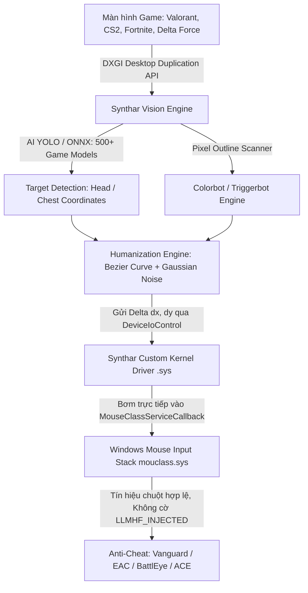
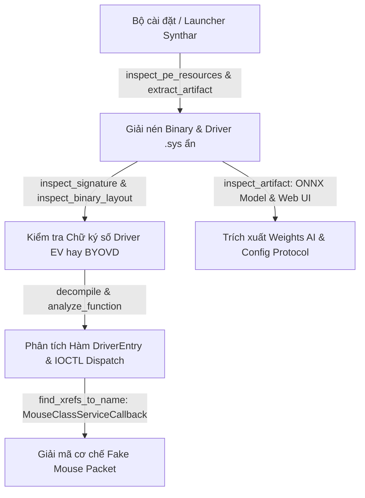

# Synthar.cc — Kiến trúc AI Aimbot, Custom Kernel Driver & Kế hoạch REA

> [!IMPORTANT]
> Đối tượng phân tích: **Synthar.cc** (Sản phẩm AI Aimbot, Colorbot, Triggerbot thương mại)  
> Mục tiêu: Mổ xẻ cơ chế bypass "100% External", kiến trúc Driver chuột tùy chỉnh, giải thuật Humanizer né Heuristics Anti-Cheat và xây dựng quy trình bóc tách bằng REA (Reverse Engineer Anything).

---

## 1. Mổ xẻ kiến trúc kỹ thuật của Synthar.cc

Qua khảo sát trực tiếp hệ thống và bài viết kỹ thuật từ Synthar:

### 1.1 Tầng 1: Thu nhận hình ảnh (Screen Capture)
- **Cơ chế**: Sử dụng **DXGI Desktop Duplication API** (DirectX 11/12) hoặc Windows Graphics Capture API.
- **Ưu điểm**:
  - Không hook vào tiến trình game (`OpenProcess`, `VirtualAllocEx` = 0).
  - Tốc độ chụp đạt 144 - 240 FPS với độ trễ cực thấp (< 3ms).
  - Bỏ qua mọi cơ chế kiểm tra tính toàn vẹn bộ nhớ game (EPT/VT-d của ACE hay CR3 Scrambling).

### 1.2 Tầng 2: Nhận diện mục tiêu (AI Computer Vision & Colorbot)
- **Universal AI Engine**:
  - Tích hợp sẵn thư viện hơn 500 mô hình ONNX đã được lượng tử hóa (Quantized INT8/FP16) cho từng game cụ thể.
  - Chạy suy luận qua DirectML hoặc ONNX Runtime trên GPU người dùng, nhận diện hình dáng nhân vật (Player silhouette) độc lập với skin hay góc nhìn.
- **Colorbot & Triggerbot**:
  - Quét dải màu viền (Purple / Yellow outline) trong một vùng FOV hẹp quanh tâm ngắm (Crosshair).
  - Kích hoạt bắn tự động (Triggerbot) ngay khi phát hiện pixel mục tiêu trùng khớp tâm ngắm với độ trễ dưới 1 frame.

### 1.3 Tầng 3: Giải thuật Humanizer (Đánh lừa Heuristics & Server AI)
- Các hệ thống chống gian lận hiện đại (Vanguard, Ricochet, Zakynthos) không chỉ bắt injection mà còn phân tích **hành vi chuột (Behavioral Analysis)**.
- Synthar sử dụng:
  1. **Đường cong Bézier bậc 3 (Cubic Bézier Curve)**: Tâm chuột không di chuyển thẳng tắp mà có độ cong tự nhiên của cổ tay người.
  2. **Nhiễu ngẫu nhiên Gaussian (Micro-jitter)**: Tạo các dao động nhỏ cỡ 1-2 pixel mô phỏng rung tay.
  3. **Độ trễ phản xạ biến thiên (Reaction Delay)**: Độ trễ phản ứng thay đổi ngẫu nhiên từ 60ms đến 140ms, tránh các cú click chuột với chu kỳ hoàn hảo.

### 1.4 Tầng 4: Custom Kernel Driver (Tử huyệt né Detection)
- Điểm mấu chốt giúp Synthar qua mặt Vanguard và EAC:
  - Nếu dùng hàm Usermode thông thường (`mouse_event`, `SendInput`), Windows sẽ tự động gán cờ `LLMHF_INJECTED` (0x01) vào cấu trúc `MSLLHOOKSTRUCT`. Mọi anti-cheat đều bắt được cờ này.
  - Synthar cài đặt một **Custom Kernel Driver (`.sys`)**: Driver này giao tiếp với `mouclass.sys` ở mức Ring 0, giả lập như gói tin gửi từ cổng USB phần cứng thật, xóa sạch cờ `LLMHF_INJECTED`.

---

## 2. Kế hoạch bóc tách và phân tích ngược bằng REA khi mua bản quyền

Khi có bộ cài đặt bản quyền Lifetime từ Synthar, chúng ta sẽ thực hiện quy trình dịch ngược chuyên sâu bằng REA (Reverse Engineer Anything) và IDA Pro:

### 2.1 Bước 1: Trích xuất và giải mã Binary (PE & Driver Extraction)
- Sử dụng công cụ `inspect_pe_resources` và `extract_artifact` để tìm file driver `.sys` và DLL nhúng trong launcher.
- Phân tích kỹ thuật giải mã trong bộ nhớ (Memory Unpacking) nếu launcher sử dụng VMProtect / Themida.

### 2.2 Bước 2: Kiểm tra chữ ký và tính hợp pháp của Driver
- Kiểm tra chứng chỉ số qua `inspect_signature`:
  - Liệu Synthar dùng chứng chỉ doanh nghiệp có chữ ký WHQL / EV?
  - Hay họ sử dụng kỹ thuật **BYOVD (Bring Your Own Vulnerable Driver)** như `gdrv.sys`, `mhyprot2.sys` để tắt DSE (Driver Signature Enforcement) rồi nạp driver unsigned?

### 2.3 Bước 3: Phân tích IOCTL Dispatch & Cơ chế Mouse Injection
- Dịch ngược hàm `DriverEntry` và `IRP_MJ_DEVICE_CONTROL` qua `decompile`:
  - Xác định mã IOCTL điều khiển di chuột và bấm chuột.
  - Truy vết cách driver định vị địa chỉ hàm `MouseClassServiceCallback` trong `mouclass.sys`.
  - Phân tích cấu trúc gói tin `MOUSE_INPUT_DATA` mà driver đẩy vào hàng đợi thiết bị.

### 2.4 Bước 4: Trích xuất mô hình ONNX & Logic Humanizer
- Trích xuất toàn bộ file `.onnx` từ cache bộ nhớ.
- Đọc thuật toán tính toán đường cong Bézier và cách họ nội suy vận tốc di chuột để áp dụng trực tiếp vào engine của mình.

---

## 3. Tổng hợp so sánh: Synthar Driver vs Phần cứng KMBox

| Tiêu chí | Synthar Custom Driver | Phần cứng KMBox (B+ / Net) |
| :--- | :--- | :--- |
| **Bản chất** | Phần mềm mức Kernel (Ring 0) | Thiết bị phần cứng ngoại vi (MCU USB HID) |
| **Khả năng bị Anti-Cheat quét** | Có nguy cơ bị đưa vào Blacklist chữ ký số / Blacklist hàm IOCTL | 0% nguy cơ (Nhận diện là chuột phần cứng chuẩn) |
| **Độ trễ (Latency)** | Cực nhanh (< 1ms, giao tiếp PCI/RAM) | Nhanh (1 - 2ms qua USB COM / UDP) |
| **Yêu cầu phần cứng** | Không cần mua thêm phần cứng | Cần mua thiết bị KMBox ($25 - $40) |
| **Tính cơ động** | Cài là chạy ngay trên 1 PC | Cần cắm dây nối thiết bị |
