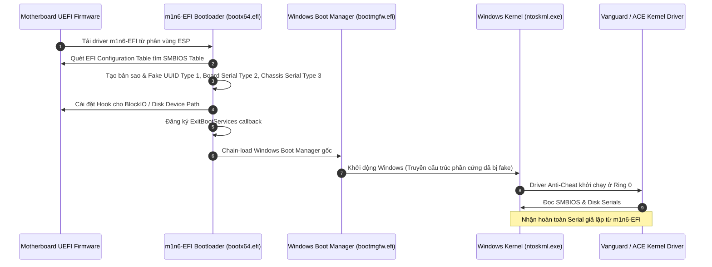

# ⚙️ Thiết Kế Kiến Trúc: m1n6-EFI Bootloader & Runtime Driver

Parent: [[docs/00_Index_MOC]]  
Related: [[docs/architecture/kernel_anticheat_analysis]] | [[docs/architecture/overview]]

---

## 1. Cơ Chế Hoạt Động (Execution Flow)

---

## 2. Các Protocol & Struct Can Thiệp

1. **`gEfiSmbiosProtocolGuid` / `SMBIOS_TABLE_GUID`**:
   - Quét qua mảng con trỏ `SystemTable->ConfigurationTable`.
   - Tìm kiếm GUID của `SMBIOS_TABLE_GUID` (32-bit entry) và `SMBIOS3_TABLE_GUID` (64-bit entry).
   - Duyệt các header `SMBIOS_HEADER`:
     - Type 1: Sửa chuỗi `SerialNumber`, ghi đè 16 bytes `UUID`.
     - Type 2: Sửa chuỗi `SerialNumber` của bo mạch chủ.
     - Type 3: Sửa chuỗi `SerialNumber` của case/chassis.

2. **`gEfiDiskInfoProtocolGuid` & `gEfiBlockIoProtocolGuid`**:
   - Chặn các hàm `Inquiry` và `IdentifyData` của chuẩn ATA/NVMe tại thời điểm boot để trả về Model & Serial number mới.

3. **Cài Đặt & Kích Hoạt Từ Windows GUI (C# `EfiInstaller`)**:
   - Mount phân vùng EFI System Partition (ESP) tạm thời bằng `mountvol X: /s`.
   - Sao lưu file `EFI\Boot\bootx64.efi` gốc thành `EFI\Boot\bootx64_orig.efi`.
   - Chép binary `m1n6-efi.efi` vào `EFI\Boot\bootx64.efi` để chiếm quyền ưu tiên khởi động.
   - Gọi `bcdedit /set {bootmgr} path \EFI\Boot\bootx64.efi` (hoặc tạo entry boot chuyên biệt).
   - Gỡ mount partition an toàn: `mountvol X: /d`.
