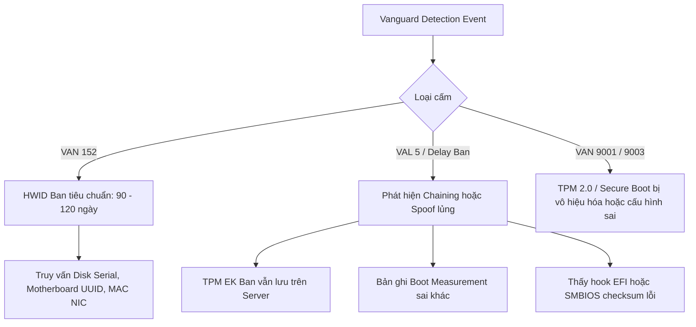
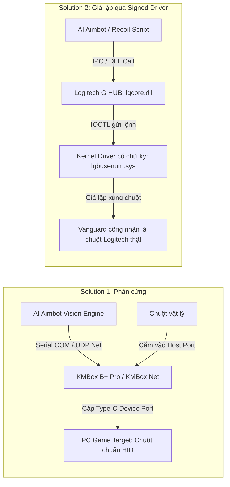
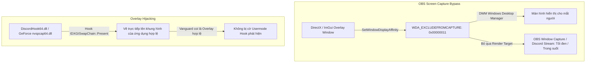

# Vanguard (Valorant) Anti-Cheat Architecture & Bypass Ecosystem

> [!IMPORTANT]
> Tài liệu kỹ thuật chi tiết phân tích cơ chế bảo mật của Riot Vanguard (`vgk.sys`), đánh giá hiện trạng mã nguồn dự án `m1n6-spoofy`, kiến trúc Mouse Input Bypass (KMBox / Logitech G HUB) cho AI Aimbot/Recoil, và kỹ thuật Overlay Hijack / OBS Screen Capture Bypass.

---

## 1. Đánh giá hiện trạng Spoofer hiện tại vs Vanguard

### 1.1 Những gì dự án đang có
Trong `SecHex-CMDLINE/RPZ-HWID/Program.cs` và `SecHex-GUI/cleaner.cs`:
- `DeleteValorantCache()`: Chỉ xóa thư mục `%LOCALAPPDATA%\VALORANT\saved`.
- `Valoranto()`: Chỉ gọi hàm `KillProcess` và `StopService("Vanguard")` (thực chất dịch vụ là `vgc`, driver là `vgk`).
- `SpoofSMBIOS()`: Sửa Registry key `HARDWARE\DESCRIPTION\System\BIOS`.
- `SpoofDisk()`: Sửa Registry key `HARDWARE\DEVICEMAP\Scsi`.

### 1.2 Tại sao KHÔNG ĐỦ để qua mặt Vanguard?
1. **Kernel Driver cấp Boot-Start (Ring 0)**:
   - `vgk.sys` khởi động cùng Windows (StartType = 1 hoặc 0). Khi user mở tool spoof trong Usermode (Ring 3), `vgk.sys` **đã ghi nhận xong toàn bộ thông tin phần cứng gốc** từ lúc boot.
   - Vanguard **hoàn toàn bỏ qua Registry**. Nó gửi trực tiếp IRP (I/O Request Packet) tới `storahci.sys` / `storvsc.sys` / `nvme.sys` (`IOCTL_STORAGE_QUERY_PROPERTY`, `SMART_RCV_DRIVE_DATA`) để đọc Serial Number thật từ controller phần cứng.
   - SMBIOS được Vanguard quét trực tiếp từ Physical Memory (`0xF0000` - `0xFFFFF`) hoặc gọi `GetSystemFirmwareTable('RSMB')` mức kernel, bỏ qua mọi thay đổi trong Registry.
2. **TPM 2.0 & Secure Boot (Cột mốc tử huyệt)**:
   - Trên Windows 11 (và đa số máy Windows 10 hiện nay), Vanguard bắt buộc TPM 2.0 (`VAN 9001` / `VAN 9003`).
   - Vanguard đọc **TPM 2.0 Endorsement Key (EK)** và **EK Certificate**. Khóa này được đúc cứng trong chip TPM (fTPM/dTPM) bởi nhà sản xuất bo mạch chủ (Intel/AMD/ASUS/Gigabyte) và ký số mật mã.
   - Khi bị ban HWID (mã lỗi **VAN 152** hoặc **VAL 5** sau 1-3 trận), EK của TPM đã bị Riot cho vào danh sách đen. Mọi spoofer usermode/kernel thông thường không thể giả mạo chữ ký số của EK Certificate.

---

## 2. Phân loại mã lỗi Ban của Vanguard

- **VAN 152**: Máy bị gắn cờ HWID ban hoàn toàn. Nếu đổi Disk, MAC, SMBIOS mà chưa xử lý TPM, tài khoản mới vẫn sẽ dính `VAL 5` sau từ 5 phút đến 2 trận đấu (Delay Ban).
- **VAL 5**: Riot Server phát hiện tính liên đới tài khoản qua:
  1. TPM EK certificate không đổi.
  2. Router Gateway ARP/MAC không đổi.
  3. Dấu vết Riot Client / Vanguard telemetry trong LocalAppData/Registry.

---

## 3. Kiến trúc Mouse Input Bypass cho AI Aimbot & Recoil

Vanguard cài đặt các hook bàn phím và chuột mức kernel (`MouseClassServiceCallback` hook, `MouFilter` hook, và kiểm tra cờ `LLMHF_INJECTED` trong cấu trúc chuột). Các hàm `mouse_event`, `SendInput`, `SetCursorPos` đều gắn cờ giả lập và sẽ khiến tài khoản ăn ban lập tức.

### 3.1 Phương án 1: Phần cứng chuyên dụng (KMBox B+ Pro / KMBox Net)
- **Cơ chế**:
  - Thiết bị vi điều khiển độc lập (MCU STM32 / ESP32) có 2 cổng: 1 cổng nhận tín hiệu chuột thật (Host) và 1 cổng kết nối với PC dưới danh nghĩa chuột phần cứng USB HID thông thường.
  - Phần mềm AI Aimbot gửi tọa độ điều khiển `dx, dy` qua cổng Serial COM (KMBox B+ Pro) hoặc mạng nội bộ UDP Socket (KMBox Net).
- **Ưu điểm**:
  - **100% vô hình đối với Vanguard**: Vanguard chỉ thấy một thiết bị chuột USB thông thường gửi gói tin HID chuẩn, hoàn toàn không có tiến trình/driver can thiệp vào stack driver chuột của Windows.
  - Hỗ trợ phần cứng phụ (2nd PC setup) nếu kết hợp qua HDMI Capture Card, biến thành setup DMA/AI External an toàn tuyệt đối.
- **Nhược điểm**:
  - Yêu cầu người dùng phải có thiết bị phần cứng KMBox (chi phí ~25$ - 40$).

### 3.2 Phương án 2: Phần mềm gián tiếp qua Signed Driver (Logitech G HUB / Razer)
- **Cơ chế**:
  - Khai thác phần mềm chuột chính hãng của Logitech (G HUB) hoặc Razer (Synapse).
  - Tận dụng driver có chữ ký số của Logitech (`lgbusenum.sys`, `logi_joy_vir_hid.sys`).
  - Giao tiếp qua `lgcore.dll` hoặc gửi trực tiếp `DeviceIoControl` tới symlink của driver Logitech.
- **Ưu điểm**:
  - Không cần mua thêm phần cứng KMBox.
  - Driver gốc của Logitech được Vanguard cho phép hoạt động (whitelist).
- **Rủi ro & Cách khắc phục**:
  - Vanguard có thể giám sát tiến trình gọi vào `lgcore.dll`. Nếu một tiến trình lạ hoặc chưa ký số liên tục gọi hàm di chuột của Logitech, Vanguard có thể gắn cờ heuristics.
  - *Giải pháp*: Sử dụng tiến trình hợp lệ hoặc chèn lệnh điều khiển thông qua Lua Script có sẵn trong Logitech G HUB profile (`MoveMouseRelative`).

---

## 4. Kiến trúc Overlay Hijack & OBS Screen Capture Bypass

Khi phát triển AI Aimbot hoặc ESP External, việc render đường vẽ (ESP box, FOV circle, Recoil point) lên màn hình mà không bị Vanguard phát hiện cũng như không bị OBS lộ khi stream/quay video là bài toán then chốt.

### 4.1 OBS Window Capture Bypass (`WDA_EXCLUDEFROMCAPTURE`)
- **API**: `SetWindowDisplayAffinity(HWND hWnd, DWORD dwAffinity)` với cờ `WDA_EXCLUDEFROMCAPTURE = 0x00000011` (Windows 10 Version 2004 trở lên).
- **Cơ chế**:
  - Hệ thống Windows DWM (Desktop Window Manager) sẽ hiển thị cửa sổ overlay bình thường lên màn hình người dùng, nhưng **loại trừ hoàn toàn cửa sổ này khỏi mọi luồng chụp màn hình** (OBS Window Capture, BitBlt, Windows Graphics Capture API, Discord Stream).
  - Tránh bị phát hiện bởi cơ chế chụp màn hình định kỳ của Vanguard (chụp screenshot desktop để tìm ESP thô).

### 4.2 Discord / NVIDIA GeForce Overlay Hijacking
- **Cơ chế**:
  - Không tạo một cửa sổ Windows mới (`CreateWindowEx`) vì các cửa sổ TopMost trong suốt luôn bị Vanguard liệt kê và kiểm tra hành vi.
  - Thay vào đó, tìm kiếm cửa sổ Overlay đã có sẵn quyền vẽ của các ứng dụng uy tín:
    - **Discord**: `DiscordHook64.dll` inject vào game để render overlay chat.
    - **NVIDIA GeForce Experience**: `nvspcap64.dll` render ShadowPlay HUD.
    - **Steam Overlay**: `GameOverlayRenderer64.dll`.
  - Sử dụng kỹ thuật Hijack SwapChain của các module này để vẽ đè nội dung ESP của mình lên.
- **Ưu điểm**:
  - Vượt qua kiểm tra chữ ký cửa sổ của Vanguard.
  - Không sinh ra cửa sổ top-level mới trong danh sách `EnumWindows`.

---

## 5. Lộ trình triển khai nâng cấp m1n6-spoofy cho Valorant & AI Engine

| Giai đoạn | Nội dung kỹ thuật | Vị trí mã nguồn |
| :--- | :--- | :--- |
| **Giai đoạn 1** | Hoàn thiện tài liệu kiến trúc & phân tích vector Vanguard trong Vault | `docs/architecture/valorant_vanguard_deepdive.md` |
| **Giai đoạn 2** | Nâng cấp EFI Bootloader Driver (`m1n6-EFI`): Hook Disk Serial cấp NVMe & Virtualize SMBIOS checksum | `m1n6-EFI/` |
| **Giai đoạn 3** | Xây dựng Module Mouse Input Adapter: Hỗ trợ cả KMBox (COM/Net) và Logitech G HUB injection | `SecHex-GUI/InputBypass/` |
| **Giai đoạn 4** | Xây dựng Module Overlay Engine: Hỗ trợ `WDA_EXCLUDEFROMCAPTURE` và Discord Hijack | `SecHex-GUI/Overlay/` |
| **Giai đoạn 5** | Cập nhật UI & Build kiểm thử toàn diện | `SecHex-GUI/` & `RPZ-HWID/` |
